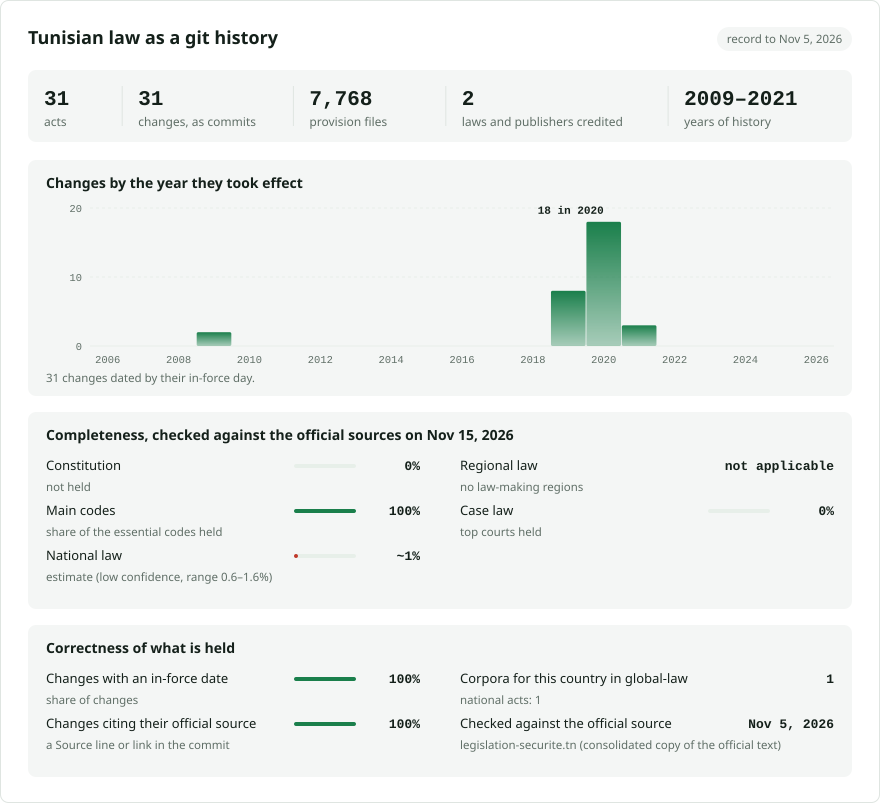

# Tunisia: law history in git

[Français](README.md) · **English**

<picture>
<source media="(prefers-color-scheme: dark)" srcset="data/effort-dark.svg">

</picture>

The law of Tunisia as a git history: one file per article, one commit per version on the day it took effect, and the law that made each change as the commit's author (the publisher, for a text available only as consolidated). `git blame` names the source of every line; `git log` lists every change to an article; picking a date gives the text in force that day.

Part of [lexifina/global-law](https://github.com/lexifina/global-law), one git history for every country's law: this is Tunisia's national law, which global-law reads at `tunisia/national/acts/`.

**What is in it now:** 31 acts, one version each, with 7,737 articles: 30 codes in force as the Imprimerie Officielle de la République Tunisienne (IORT) consolidated them in its French editions (the Code du travail, the Code pénal, the Code des obligations et des contrats, the Code du statut personnel and 26 others), and Loi n° 94-36 of 24 February 1994 on literary and artistic property, as amended by Loi n° 2009-33. Each act's folder has a `README.md` listing its articles; [`data/versions.json`](data/versions.json) gives each version's day and source.

Each act is a folder with one file per article: the codes are in `code/<name>/` (`code/code-du-travail/art-0112.md` is Article 112 of the Code du travail), Loi n° 94-36 in `propriete-litteraire-artistique/`. Until 11 November 2026 each code's folder was named by its id (`code-du-travail/`); [`data/paths.json`](data/paths.json) maps each id to its folder, and the version tags (`code-du-travail/2020-09-29`) keep the ids.

The text is in French, from the IORT's French editions. The authoritative text is the Arabic one in the Journal Officiel de la République Tunisienne (JORT); it and an English translation are not part of this record.

## Questions as git commands

| Question | Command |
| --- | --- |
| Every change to Article 112 of the Code du travail | `git log -p --follow --word-diff -- code/code-du-travail/art-0112.md` |
| Which source wrote each line of Article 112? | `git blame code/code-du-travail/art-0112.md` |
| Every version of the Code du travail, with the day each took effect | `git log --no-walk --tags="code-du-travail/*" --format="%h %(trailers:key=In-force,valueonly,separator=) %an"` |
| Article 112 as in force on 1 January 2026 | `python tools/on.py 2026-01-01 code/code-du-travail art-0112` |

Each act has one version here, so each list has one entry; `git log --follow` also shows the commit of 11 November 2026 that moved the folder, with no change to the text.

**Outside git**, we also host this record publicly, for free:

- **[Ask Claude about Tunisian law](https://global-law.lexifina.com/v1/try_claude?country=tunisia)**: opens Claude with a first question ready.
- **[Ask ChatGPT](https://global-law.lexifina.com/v1/try_chatgpt?country=tunisia)**: the same question in ChatGPT.
- **[Search Tunisian law on our site](https://lexifina.com/law?country=tunisia&q=cong%C3%A9+annuel)**: a search for "congé annuel" (annual leave), with each provision's text and its versions, no account needed.
- **[Developer REST API](https://global-law.lexifina.com/v1/search_law?query=cong%C3%A9+annuel&jurisdiction=tunisia)**: the same search as JSON, with no key. See the [documentation here](https://lexifina.com/api/global-law).

Both assistants read the record through the free Global law connector (MCP, `https://global-law.lexifina.com/mcp`); the first time, the chat gives you the link that adds it. Ask in French or in English.

**Host it yourself easily.** All it takes is git and Python, and the tools run on your machine:

```sh
git clone --depth 1 https://github.com/lexifina/global-law && cd global-law
python3 tools/countries.py add tunisia/national/acts
python3 tools/law.py show 2026-01-01 tunisia/national/acts/code/code-du-travail/art-0112.md
```

Opened in Claude Code, Cursor, VS Code or Codex, the clone also starts a local MCP server with the same tools ([MCP.md](https://github.com/lexifina/global-law/blob/main/MCP.md)).

## Dates

Each commit is dated at noon, Africa/Tunis, on the day the version took effect, and carries it in its `In-force:` trailer:

- 29 codes: the day the Internet Archive captured the IORT edition from legislation.tn (15 July 2019 to 1 March 2021), as the edition does not say when the last amendment it includes took effect;
- the Code de l'aéronautique civile: 18 May 2009. Its last amendment, Loi n° 2009-25, appeared in JORT n° 38 of 12 May 2009, deposited in Tunis on 13 May, and Loi n° 93-64, article 2, makes a text executable five days after deposit, not counting the deposit day; the edition's date, 19 January 2018, is editorial;
- Loi n° 94-36: 23 June 2009, the date of Loi n° 2009-33, whose amendments the consolidated copy includes; the copy gives neither law's JORT date.

Every version here is the oldest version available and is credited to its publisher: the codes to `Imprimerie Officielle de la République Tunisienne (legislation.tn)`, Loi n° 94-36 to `legislation-securite.tn`. The committer is Lexifina.

## How it is checked

- `tools/check_repo.py` reads every version back from git on the day it took effect and on the day before, compares it file by file with the corpus it was built from, and checks that every commit's trailers parse, with no merge commits and no commit dated in the future.
- The same corpus always gives the same commit hashes; [`REPRODUCE.md`](REPRODUCE.md) gives the corpus's sha256, the builders' blob hashes and the decisions made by hand. It also records that, for the published build, that check had not yet been run and no second build had been compared.
- Every text comes from a PDF's text layer; no OCR output is in the repository.
- [vulnerabilities/](vulnerabilities/README.en.md): possible drafting mistakes in this law, found by global-law's detectors and checked by hand. Not run yet.

## What it does not show

- **Most of Tunisian law.** Only these 31 acts are here: no Constitution, no other laws or decrees, and no case law. The only official Arabic copy of the 2022 Constitution found is a scan that OCR could not read, so it was left out.
- **History.** Each act is one consolidated text: earlier wordings and the amending laws as separate versions are not here, nor Loi n° 94-36 as enacted in 1994.
- **Later amendments.** Changes made after each code's edition was captured (2019 to 2021) are not applied.
- **Headings and notes.** The promulgating law or decree printed before a code, the headings of books, titles, chapters and sections, the footnotes, and the editors' notes naming the law that added, amended or repealed an article are left out; an article printed only as repealed keeps that note as its text.
- **The decrees printed after the Code de l'aéronautique civile** under "ANNEXES", which are separate instruments.

## Sources

| Source | Kind | Past versions | Notes |
| --- | --- | --- | --- |
| [legislation.tn](http://www.legislation.tn/fr/recherche/codes-en-vigueur) (IORT) | National legal information portal: consolidated French editions of the codes in force | one consolidated text per code | 30 codes, read from the Internet Archive's captures of the portal's PDFs |
| [legislation-securite.tn](https://legislation-securite.tn/) | Consolidated copy of the official text | one text | Loi n° 94-36 as amended by Loi n° 2009-33, retrieved 30 October 2026 |
| [IORT](http://www.iort.gov.tn/) | Journal Officiel (JORT) | as published | JORT n° 38 of 12 May 2009 and n° 50 of 6 July 1993, for the Code de l'aéronautique civile's day |

## Licence

See [`LICENSE`](LICENSE). Official legislative texts and their official translations are outside copyright in Tunisia (Loi n° 94-36, article premier, as amended by Loi n° 2009-33); the IORT marks its editions "Tous droits réservés", but the texts in them are official texts. Lexifina's arrangement of the history, its commit messages, tables and tools are dedicated to the public domain under CC0 1.0.

No AI model wrote, translated or corrected legal text, and none runs at build time; the scripts were written by Claude Code (see [`REPRODUCE.md`](REPRODUCE.md)).

## Visualisations

- [visualisations/](visualisations/README.en.md): charts drawn from this repository. Not drawn yet.

## More

From [lexifina/global-law](https://github.com/lexifina/global-law):

- [FEATURES.md](https://github.com/lexifina/global-law/blob/main/FEATURES.md): every feature, and what every corpus must support (`git blame`, `law.py`, the MCP tools)
- [FAQ.md](https://github.com/lexifina/global-law/blob/main/FAQ.md): questions and answers · [CONTRIBUTING.md](https://github.com/lexifina/global-law/blob/main/CONTRIBUTING.md): proposing changes · [MCP.md](https://github.com/lexifina/global-law/blob/main/MCP.md): the MCP server · [REPRODUCE.md](https://github.com/lexifina/global-law/blob/main/REPRODUCE.md): how it was built · [CHANGELOG.md](https://github.com/lexifina/global-law/blob/main/CHANGELOG.md)
- [FRESHNESS.md](https://github.com/lexifina/global-law/blob/main/FRESHNESS.md): how current each corpus is · [Monitoring](https://github.com/lexifina/global-law/tree/main/monitoring): whether updates are running · [WATCHING.md](https://github.com/lexifina/global-law/blob/main/WATCHING.md): how each official source is watched for changes
- [performance/](https://github.com/lexifina/global-law/tree/main/performance): how fast the tools are, measured
- [visualisations/](https://github.com/lexifina/global-law/tree/main/visualisations): charts and bridges across the world's law
- [Vulnerabilities](https://github.com/lexifina/global-law/tree/main/vulnerabilities): mistakes in legislation as published
