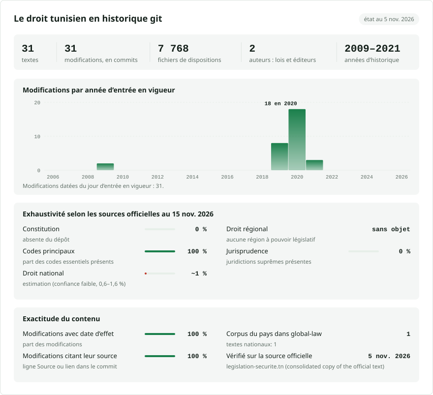

# Tunisie : l’histoire du droit dans git

**Français** · [English](README.en.md)

<picture>
<source media="(prefers-color-scheme: dark)" srcset="data/fr/effort-dark.svg">

</picture>

Le droit de la Tunisie sous la forme d’un historique git : un fichier par article, un commit par version à la date de son entrée en vigueur, et la loi auteur de chaque modification comme auteur du commit (l’éditeur, pour un texte disponible uniquement en version consolidée). `git blame` indique la source de chaque ligne ; `git log` liste toutes les modifications d’un article ; le choix d’une date donne le texte en vigueur ce jour-là.

Fait partie de [lexifina/global-law](https://github.com/lexifina/global-law), un historique git unique pour le droit de tous les pays : il s’agit ici du droit national de la Tunisie, que global-law lit sous `tunisia/national/acts/`.

**Contenu actuel :** 31 textes, en une version chacun, totalisant 7 737 articles : 30 codes en vigueur tels que l’Imprimerie Officielle de la République Tunisienne (IORT) les a consolidés dans ses éditions françaises (le Code du travail, le Code pénal, le Code des obligations et des contrats, le Code du statut personnel et 26 autres), et la Loi n° 94-36 du 24 février 1994 relative à la propriété littéraire et artistique, telle que modifiée par la Loi n° 2009-33. Le dossier de chaque texte contient un `README.md` listant ses articles ; [`data/versions.json`](data/versions.json) donne la date et la source de chaque version.

Chaque texte est un dossier avec un fichier par article : les codes se trouvent dans `codes/<name>/` (`codes/code-du-travail/art-0112.md` est l’article 112 du Code du travail), la Loi n° 94-36 dans `lois/1994/036-propriete-litteraire-et-artistique/`. Jusqu’au 11 novembre 2026, le dossier de chaque code portait son identifiant (`code-du-travail/`) ; [`data/paths.json`](data/paths.json) fait correspondre chaque identifiant à son dossier, et les étiquettes de version (`code-du-travail/2020-09-29`) conservent les identifiants.

Le texte est en français, tiré des éditions françaises de l’IORT. Le texte qui fait foi est le texte arabe publié au Journal Officiel de la République Tunisienne (JORT) ; ni celui-ci ni une traduction anglaise ne font partie de ce corpus.

## Questions sous forme de commandes git

| Question | Commande |
| --- | --- |
| Toutes les modifications de l’article 112 du Code du travail | `git log -p --follow --word-diff -- codes/code-du-travail/art-0112.md` |
| Quelle source a rédigé chaque ligne de l’article 112 ? | `git blame codes/code-du-travail/art-0112.md` |
| Toutes les versions du Code du travail, avec la date d’entrée en vigueur de chacune | `git log --no-walk --tags="code-du-travail/*" --format="%h %(trailers:key=In-force,valueonly,separator=) %an"` |
| L’article 112 tel qu’en vigueur au 1er janvier 2026 | `python tools/on.py 2026-01-01 codes/code-du-travail art-0112` |

Chaque texte n’ayant ici qu’une version, chaque liste ne comporte qu’une entrée ; `git log --follow` montre aussi le commit du 11 novembre 2026 qui a déplacé le dossier, sans modification du texte.

**En dehors de git**, nous hébergeons aussi ce corpus publiquement, gratuitement :

- **[Interroger Claude sur le droit tunisien](https://global-law.lexifina.com/v1/try_claude?country=tunisia)** : ouvre Claude avec une première question prête.
- **[Interroger ChatGPT](https://global-law.lexifina.com/v1/try_chatgpt?country=tunisia)** : la même question dans ChatGPT.
- **[Rechercher dans le droit tunisien sur notre site](https://lexifina.com/law?country=tunisia&q=cong%C3%A9+annuel)** : une recherche de « congé annuel », avec le texte de chaque disposition et ses versions, sans compte.
- **[API REST pour développeurs](https://global-law.lexifina.com/v1/search_law?query=cong%C3%A9+annuel&jurisdiction=tunisia)** : la même recherche au format JSON, sans clé. Voir la [documentation ici](https://lexifina.com/api/global-law).

Les deux assistants lisent le corpus au moyen du connecteur gratuit Global law (MCP, `https://global-law.lexifina.com/mcp`) ; la première fois, la conversation vous donne le lien qui l’ajoute. Posez vos questions en français ou en anglais.

**L’héberger vous-même, simplement.** Il suffit de git et de Python, et les outils s’exécutent sur votre machine :

```sh
git clone --depth 1 https://github.com/lexifina/global-law && cd global-law
python3 tools/countries.py add tunisia/national/acts
python3 tools/law.py show 2026-01-01 tunisia/national/acts/codes/code-du-travail/art-0112.md
```

Ouvert dans Claude Code, Cursor, VS Code ou Codex, le clone démarre aussi un serveur MCP local doté des mêmes outils ([MCP.md](https://github.com/lexifina/global-law/blob/main/MCP.md)).

## Dates

Chaque commit est daté à midi, heure Africa/Tunis, du jour où la version est entrée en vigueur, et porte cette date dans son trailer `In-force:` :

- 29 codes : la date à laquelle l’Internet Archive a capturé l’édition de l’IORT sur legislation.tn (du 15 juillet 2019 au 1er mars 2021), l’édition n’indiquant pas la date d’entrée en vigueur de la dernière modification qu’elle intègre ;
- le Code de l'aéronautique civile : le 18 mai 2009. Sa dernière modification, la Loi n° 2009-25, a paru au JORT n° 38 du 12 mai 2009, déposé à Tunis le 13 mai, et la Loi n° 93-64, en son article 2, rend un texte exécutoire cinq jours après son dépôt, le jour du dépôt non compris ; la date de l’édition, le 19 janvier 2018, est éditoriale ;
- la Loi n° 94-36 : le 23 juin 2009, date de la Loi n° 2009-33, dont la copie consolidée intègre les modifications ; la copie ne donne la date de publication au JORT d’aucune des deux lois.

Chaque version figurant ici est la plus ancienne version disponible et est attribuée à son éditeur : les codes à `Imprimerie Officielle de la République Tunisienne (legislation.tn)`, la Loi n° 94-36 à `legislation-securite.tn`. Le committer est Lexifina.

## Méthode de vérification

- `tools/check_repo.py` relit chaque version dans git le jour de son entrée en vigueur et la veille, la compare fichier par fichier au corpus à partir duquel elle a été construite, et vérifie que les trailers de chaque commit sont analysables, sans commit de fusion ni commit daté dans le futur.
- Un même corpus donne toujours les mêmes empreintes de commit ; [`REPRODUCE.md`](REPRODUCE.md) donne l’empreinte sha256 du corpus, les empreintes de blob des scripts de construction et les choix faits manuellement. Il consigne également que, pour la construction publiée, ce contrôle n’avait pas encore été exécuté et qu’aucune seconde construction n’avait été comparée.
- Chaque texte provient de la couche texte d’un PDF ; aucun résultat d’OCR ne figure dans le dépôt.
- [vulnerabilities/](vulnerabilities/): erreurs de rédaction possibles dans ce droit, trouvées par les détecteurs de global-law et vérifiées à la main. Pas encore lancé.

## Ce qu’il ne montre pas

- **L’essentiel du droit tunisien.** Seuls ces 31 textes figurent ici : ni Constitution, ni autres lois ou décrets, ni jurisprudence. La seule copie officielle en arabe de la Constitution de 2022 trouvée est une numérisation que l’OCR n’a pas pu lire ; elle a donc été écartée.
- **L’historique.** Chaque texte est un texte consolidé unique : les rédactions antérieures et les lois modificatives en tant que versions distinctes n’y figurent pas, pas plus que la Loi n° 94-36 telle qu’adoptée en 1994.
- **Les modifications ultérieures.** Les modifications intervenues après la capture de l’édition de chaque code (2019 à 2021) ne sont pas appliquées.
- **Les intitulés et les notes.** La loi ou le décret de promulgation imprimé avant un code, les intitulés des livres, titres, chapitres et sections, les notes de bas de page et les notes des éditeurs désignant la loi qui a ajouté, modifié ou abrogé un article sont omis ; un article imprimé uniquement comme abrogé conserve cette note pour texte.
- **Les décrets imprimés après le Code de l'aéronautique civile** sous la rubrique « ANNEXES », qui sont des textes distincts.

## Sources

| Source | Nature | Versions antérieures | Remarques |
| --- | --- | --- | --- |
| [legislation.tn](http://www.legislation.tn/fr/recherche/codes-en-vigueur) (IORT) | Portail national d’information juridique : éditions françaises consolidées des codes en vigueur | un texte consolidé par code | 30 codes, lus à partir des captures, par l’Internet Archive, des PDF du portail |
| [legislation-securite.tn](https://legislation-securite.tn/) | Copie consolidée du texte officiel | un texte | Loi n° 94-36 telle que modifiée par la Loi n° 2009-33, consultée le 30 octobre 2026 |
| [IORT](http://www.iort.gov.tn/) | Journal Officiel (JORT) | tel que publié | JORT n° 38 du 12 mai 2009 et n° 50 du 6 juillet 1993, pour la date du Code de l'aéronautique civile |

## Licence

Voir [`LICENSE`](LICENSE). Les textes législatifs officiels et leurs traductions officielles sont exclus du droit d’auteur en Tunisie (Loi n° 94-36, article premier, telle que modifiée par la Loi n° 2009-33) ; l’IORT appose sur ses éditions la mention « Tous droits réservés », mais les textes qu’elles contiennent sont des textes officiels. L’organisation de l’historique par Lexifina, ses messages de commit, ses tableaux et ses outils sont versés dans le domaine public sous CC0 1.0.

Aucun modèle d’IA n’a rédigé, traduit ni corrigé de texte juridique, et aucun ne s’exécute lors de la construction ; les scripts ont été écrits par Claude Code (voir [`REPRODUCE.md`](REPRODUCE.md)).

Ceci est une traduction de la version anglaise ([README.en.md](README.en.md)) ; en cas de divergence, la version anglaise fait foi.

## Visualisations

- [visualisations/](visualisations/): graphiques tirés de ce dépôt. Pas encore dessinés.

## En savoir plus

Dans le dépôt [lexifina/global-law](https://github.com/lexifina/global-law) (pages en anglais) :

- [FEATURES.md](https://github.com/lexifina/global-law/blob/main/FEATURES.md): toutes les fonctionnalités et ce que chaque corpus doit prendre en charge (`git blame`, `law.py`, outils MCP)
- [FAQ.md](https://github.com/lexifina/global-law/blob/main/FAQ.md): questions et réponses · [CONTRIBUTING.md](https://github.com/lexifina/global-law/blob/main/CONTRIBUTING.md): proposer une modification · [MCP.md](https://github.com/lexifina/global-law/blob/main/MCP.md): serveur MCP · [REPRODUCE.md](https://github.com/lexifina/global-law/blob/main/REPRODUCE.md): comment il a été construit · [CHANGELOG.md](https://github.com/lexifina/global-law/blob/main/CHANGELOG.md)
- [FRESHNESS.md](https://github.com/lexifina/global-law/blob/main/FRESHNESS.md): à quel point chaque corpus est à jour · [Surveillance](https://github.com/lexifina/global-law/tree/main/monitoring): si les mises à jour fonctionnent · [WATCHING.md](https://github.com/lexifina/global-law/blob/main/WATCHING.md): comment chaque source officielle est surveillée pour repérer les modifications
- [performance/](https://github.com/lexifina/global-law/tree/main/performance): la rapidité des outils, mesurée
- [visualisations/](https://github.com/lexifina/global-law/tree/main/visualisations): graphiques et liens à travers le droit du monde entier
- [Vulnérabilités](https://github.com/lexifina/global-law/tree/main/vulnerabilities): erreurs dans les textes tels qu’ils ont été publiés
